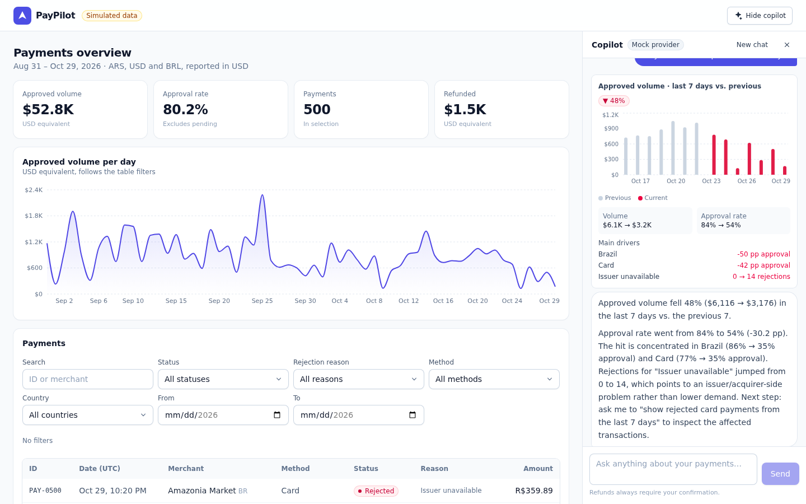
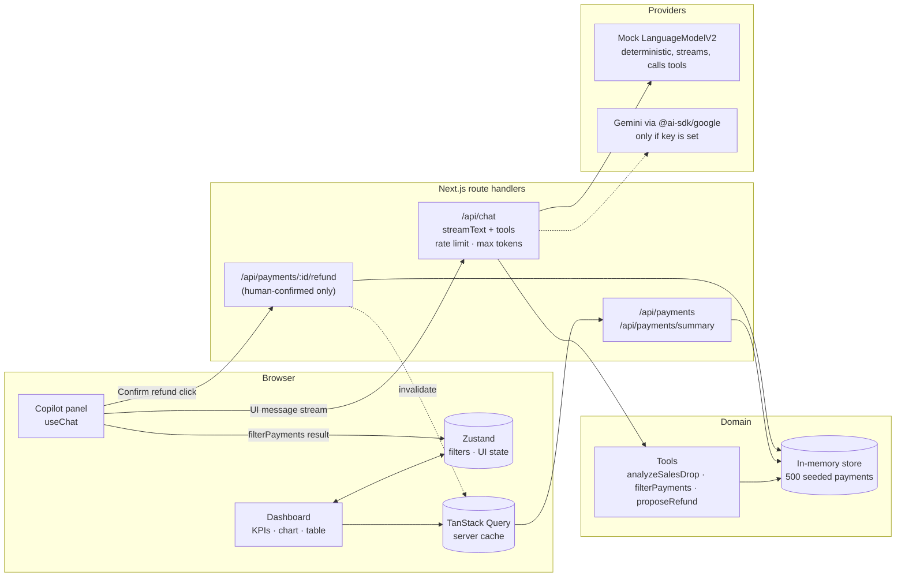

# PayPilot

**A payments operations dashboard with an AI copilot that can analyze, filter and act, with a human in the loop.**

PayPilot is a portfolio MVP. It shows how I build AI features into a real product surface: a streaming chat copilot that calls typed tools, renders rich UI (charts, filter chips, confirmation cards) inside the conversation, drives the dashboard state, and never moves money without an explicit human click.

It runs **fully offline by default**: the copilot uses a deterministic mock provider that implements the same model interface as a real LLM, so you can clone it and try every flow with no API key. Plug in a free Gemini key and the same code path talks to a real model.

> All data is simulated (500 seeded payments). No real payments, customers or PSPs are involved.



<!-- Replace with a GIF of the three demo flows once deployed (stage 2). -->

---

## Features

- **Payments dashboard**: KPIs (approved volume, approval rate, count, refunds), daily volume chart and a filterable, paginated table across ARS / USD / BRL, cards / transfers / wallets, and AR / BR / US.
- **AI copilot side panel** with streaming responses and three tools:
  1. `analyzeSalesDrop(range)` compares a window with the previous one, finds the segments and rejection reasons behind the drop, and renders a chart in the chat.
  2. `filterPayments(status, reason, method, dateRange)` applies filters to the dashboard table, the KPIs and the chart.
  3. `proposeRefund(paymentId, amount, reason)` validates and returns a **proposal**. A confirmation card appears and the refund only executes when the user clicks **Confirm refund**.
- **Provider abstraction**: a deterministic mock model by default, Gemini (`@ai-sdk/google`) when `GOOGLE_GENERATIVE_AI_API_KEY` is set. The model is configurable via env.
- **Guardrails in the chat route**: per-client rate limiting, `maxOutputTokens`, a cap on message count and size, input validation with zod, and a key that stays on the server.
- **Accessible, responsive UI**: semantic landmarks, labelled controls, `role="log"` with live regions for the conversation, keyboard support (Enter to send, Esc closes the mobile drawer), visible focus rings and reduced-motion support. The copilot is docked on desktop and becomes a slide-over on mobile.
- **Small design system** (`src/components/ui`): Button, Badge, Card, Select, Input and Skeleton, with Storybook stories.
- **Tests**: Vitest unit tests (mock data, filters, tools, mock provider, rate limiter) and Playwright E2E for the copilot flows. A GitHub Actions workflow runs it all.

## Architecture



**Request flow for a copilot message:** `useChat` posts UI messages to `/api/chat` → the route validates, rate-limits and calls `streamText` with the selected model and tools → the model emits a tool call → the tool runs on the server against the store → its typed output streams back as a `tool-*` part → the client renders the matching card (chart, filter chips or refund confirmation) → the model streams a short summary in a second step (`stopWhen: stepCountIs(4)`).

### Project structure

```
src/
  app/
    api/chat/route.ts                 # streamText + tools, guardrails, provider info (GET)
    api/payments/route.ts             # filtered + paginated list
    api/payments/summary/route.ts     # KPIs + daily series for the current filters
    api/payments/[id]/refund/route.ts # the only code path that moves money
    layout.tsx · page.tsx · providers.tsx · globals.css
  components/
    ui/                               # design system + *.stories.tsx
    dashboard/                        # AppShell, KPIs, chart, filter bar, table
    copilot/                          # panel, messages, tool result cards
  lib/
    ai/                               # tools, provider selection, rate limit, system prompt
    ai/mock/                          # mock LanguageModelV2, intent detection, responses
    data/                             # seeded generator + in-memory store
    payments/                         # types, filters, analytics, money/date utils, query hooks
  stores/dashboard-store.ts           # Zustand
tests/unit/                           # Vitest
e2e/                                  # Playwright
.storybook/                           # Storybook (react-vite)
```

## Demo flows

Each one is a suggested prompt in the empty copilot panel and an E2E test.

| #   | Prompt                                                     | What happens                                                                                                                                                                                                                                                                                                                                                              |
| --- | ---------------------------------------------------------- | ------------------------------------------------------------------------------------------------------------------------------------------------------------------------------------------------------------------------------------------------------------------------------------------------------------------------------------------------------------------------- |
| 1   | _"Why did sales drop in the last 7 days?"_                 | `analyzeSalesDrop({ range: "7d" })` finds a ~48% volume drop. Approval rate fell from 84% to 54%, concentrated in **card** payments and **Brazil**, with "Issuer unavailable" rejections going from 0 to 14. A bar chart (previous vs. current) and the drivers render in the chat.                                                                                       |
| 2   | _"Show rejected card payments from the last 7 days"_       | `filterPayments({ status: "rejected", method: "card", dateRange })` updates the table, KPIs and chart. The filter bar shows an "Applied by Copilot" badge, and the user can tweak or clear the filters.                                                                                                                                                                   |
| 3   | _"Refund PAY-0426 because the customer was charged twice"_ | `proposeRefund` validates the payment (it must be approved, and the amount can't exceed the refundable balance) and returns a proposal. **Nothing is refunded** until the user clicks **Confirm refund**, which calls the refund endpoint and refreshes the dashboard. Cancel leaves everything untouched. Partial refunds work too: _"Refund $50 of PAY-0426 because…"_. |

## Tech decisions and tradeoffs

- **Next.js App Router + route handlers as a mock backend.** The client talks HTTP to real endpoints, so swapping the in-memory store for a database or PSP API in stage 2 doesn't touch the UI. _Tradeoff:_ the store lives in server memory (on `globalThis`), so it resets on restart and isn't shared across serverless instances.
- **The mock is a real `LanguageModelV2`, not an `if (mock)` branch.** It implements `doStream`/`doGenerate`, emits tool calls and streams text, so `streamText`, tool execution, multi-step and the UI message protocol run exactly as they do with Gemini. Intent detection is keyword-based. It's deterministic, which makes the E2E tests stable, but it only understands phrasings close to the demo flows.
- **Human-in-the-loop by architecture, not by prompt.** `proposeRefund` has no side effects. Money moves only through `POST /api/payments/:id/refund`, which only a user click calls. Even a jailbroken model can't refund. _Tradeoff:_ this is enforced in the UI flow. Stage 2 would add a signed, single-use proposal token checked by the endpoint.
- **Server-executed tools with typed outputs.** Tool results (`InferUITools`) give type-safe rendering per `tool-*` part. `filterPayments` runs on the server (to count matches) and the client applies it to Zustand once per `toolCallId`, which is safe under re-renders and Strict Mode.
- **Zustand for UI state, TanStack Query for server state.** Filters and panel state are client concerns. Payments and summary are cached by query key, use `keepPreviousData` for smooth pagination, and get invalidated after a refund.
- **Deterministic, seeded data** (mulberry32, fixed end date 2026-10-29) with a planted incident: a card issuer outage in the last 7 days, worst in Brazil. The analytics have a real signal to find, and the tests assert it.
- **Guardrails sized for a demo.** The in-memory fixed-window rate limiter (20 req/min per IP, configurable) and the token and message caps protect a free-tier key. _Tradeoff:_ per instance only, so stage 2 moves it to a shared store.
- **Native `<select>`/`<input>` in the design system** for free accessibility and mobile UX, instead of custom listboxes.
- **No markdown library.** A tiny safe renderer covers bold and bullets without `dangerouslySetInnerHTML`.

## Run locally

Requirements: Node 20.9+ (22 recommended).

```bash
npm install
npm run dev            # http://localhost:3000, mock copilot, no key needed
```

### Optional: real LLM (Gemini free tier)

```bash
cp .env.example .env.local
# set GOOGLE_GENERATIVE_AI_API_KEY=... (from https://aistudio.google.com/apikey)
# optional: GEMINI_MODEL=gemini-2.5-flash
npm run dev
```

The panel badge switches from "Mock provider" to "Gemini · model". The key is read only on the server (no `NEXT_PUBLIC_` prefix) and never reaches the browser. Set `COPILOT_PROVIDER=mock` to force the mock even when a key is present.

## Testing and quality

```bash
npm run lint           # ESLint (next/core-web-vitals + typescript) + Prettier compat
npm run format:check   # Prettier
npm run typecheck      # tsc --noEmit (strict, noUncheckedIndexedAccess)
npm test               # Vitest unit tests
npm run build          # production build
npx playwright install chromium
npm run test:e2e       # Playwright against `next start` with the mock provider (run build first)
npm run storybook      # design system on http://localhost:6006
```

CI (`.github/workflows/ci.yml`) runs lint, format check, typecheck, unit tests and a Storybook build, then a production build and the Playwright suite. No secrets are required.

## Roadmap

**Stage 2: real LLM + deploy**

- Deploy on Vercel with Gemini as the default provider (free tier), keeping mock mode for previews and CI.
- Shared rate limiting (Upstash/Vercel KV), signed single-use refund proposals, and an audit log.
- Evals for tool selection and argument extraction on a fixed prompt set (mock vs. Gemini).
- Persist data in a real database (e.g. Postgres/Neon) and conversation history.
- More tools: anomaly alerts, cohort comparisons, CSV export; i18n (es/pt-BR).

## License

[MIT](LICENSE) © Gustavo Estay
